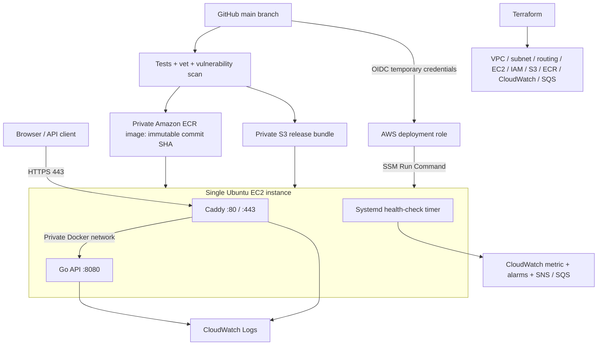

# Go AWS Platform

[](https://github.com/rhysch/go-aws-platform/actions/workflows/ci.yaml)
[](https://github.com/rhysch/go-aws-platform/actions/workflows/release.yaml)

**[Live HTTPS demo](https://go-platform.16-113-199-23.sslip.io)** · **[Deployment evidence](docs/evidence/2026-11-19-deployment.md)**

A personal DevOps portfolio project: a small Go HTTP service with reproducible AWS infrastructure, Docker delivery, Caddy HTTPS, deployment verification, and release recovery.

**Start with [START_HERE.md](START_HERE.md).** Work through one checkpoint at a time. The AWS deployment has been verified through GitHub Actions and an independent public HTTPS smoke test. See [verification status](docs/VERIFICATION.md) for the tested scope and limitations.

## Architecture



The application has no database. `/readyz` therefore has no external dependency to check. This keeps attention on infrastructure and operations.

## Local quick start

Requirements: Go 1.22.2 or later, Docker Engine with Compose plugin. Terraform 1.10+ and AWS CLI v2 are needed only for cloud deployment.

```bash
go test -race ./...
go run ./cmd/api
```

In a second terminal, from this repository:

```bash
go run ./cmd/smoke -url http://localhost:8080 -expect-version dev
```

Stop the Go server with Ctrl+C before running the container stack:

```bash
docker compose up -d --build --wait
go run ./cmd/smoke -url http://localhost:8088 -expect-version local
docker compose down
```

Port 8088 reaches Caddy, which proxies to Go. Port 8080 is bound only to loopback for direct diagnostics. If occupied, use `APP_PORT=18080 PROXY_PORT=18088 docker compose up -d --build --wait`, then test port 18088. Use the same port variables for subsequent Compose commands.

## Endpoints

| Method | Path | Meaning |
|---|---|---|
| GET | `/` | Welcome response |
| GET | `/healthz` | Process can answer HTTP |
| GET | `/readyz` | Application is ready to serve |
| GET | `/version` | Exact build/release version as JSON |

Unknown paths return 404. Other methods on known endpoints return 405 with `Allow: GET`. The service emits JSON request logs. The Go executable supports a `healthcheck` subcommand for the scratch image.

## Delivery design

- PR CI: format check, Go tests with race detection, vet, image build/scan, local Compose smoke test, Terraform format/validation, shell checks.
- Documentation-only pushes run CI but do not create an application release. Manual workflow dispatch remains available.
- Main release: independently reruns Go tests and image scanning, assumes an AWS role via OIDC, scans and publishes the image to private ECR under an immutable commit-SHA tag, packages deployment files, and deploys using SSM.
- The server pulls the exact release image, validates Caddy configuration, waits for healthy containers, verifies the local release version and the public HTTPS version, then updates a `current` symlink.
- A deployment failure attempts to restore the last successful release. On a first deployment there is no previous release. Rollback is best-effort, can itself fail, and must be verified.
- Workflow dispatch with a prior full commit SHA redeploys the existing archived release. Run it from `main`.
- Infrastructure changes use a separately reviewed Terraform plan and explicit local apply. Application workflows cannot apply Terraform or read its state.

ECR enforces immutable commit-SHA image tags. Rerunning a release reuses and scans its existing image rather than overwriting it. EC2 uses a temporary ECR login during deployment; no registry password is retained afterward.

## Repository map

```text
cmd/api/              Server entry point and graceful shutdown
cmd/smoke/            Go deployment verification command and tests
internal/web/         Routing, structured logs, and handler tests
Dockerfile            Multi-stage static Go build; non-root scratch runtime
compose.yaml          Local HTTP demonstration with Caddy
Caddyfile.local       Local reverse proxy configuration
deploy/               AWS Compose and HTTPS Caddy configuration
infra/bootstrap/      Private state bucket and optional GitHub OIDC provider
infra/app/            Application infrastructure and cloud-init
scripts/              Deployment, SSM orchestration, and health metric
docs/                 Deployment, learning, interview, and operations guides
.github/workflows/    CI and release workflows
```

## Learn and deploy

1. [Learning checkpoints](START_HERE.md)
2. [AWS deployment guide](docs/DEPLOYMENT.md)
3. [Architecture and code explained](docs/EXPLAINED.md)
4. [Failure drills and recovery](docs/RUNBOOK.md)
5. [Interview questions and CV wording](docs/INTERVIEW.md)
6. [Local verification and cloud evidence](docs/VERIFICATION.md)
7. [CV project bullets](docs/CV.md)

## Boundaries

This is a single-instance platform: application updates can briefly interrupt traffic and instance failure causes downtime. It does not implement high availability, autoscaling, Kubernetes, a database, or persistent business data. Caddy certificate data lives on the instance disk; protect it separately if you need to preserve it across instance replacement. Terraform state is infrastructure metadata, not a backup of server files.

AWS deployment creates billable resources, including EC2, EBS, public IPv4, CloudWatch, S3, ECR and SQS. Set an AWS Budget and review current regional pricing before applying. No free-tier claim is made. A single instance avoids NAT gateway and load balancer costs but trades away resilience.

## References

- [Docker Engine on Ubuntu](https://docs.docker.com/engine/install/ubuntu/)
- [Terraform S3 backend and native locking](https://developer.hashicorp.com/terraform/language/backend/s3)
- [GitHub OIDC with AWS](https://docs.github.com/en/actions/how-tos/secure-your-work/security-harden-deployments/oidc-in-aws)
- [AWS IAM OIDC roles](https://docs.aws.amazon.com/IAM/latest/UserGuide/id_roles_create_for-idp_oidc.html)
- [Caddy automatic HTTPS](https://caddyserver.com/docs/automatic-https)
